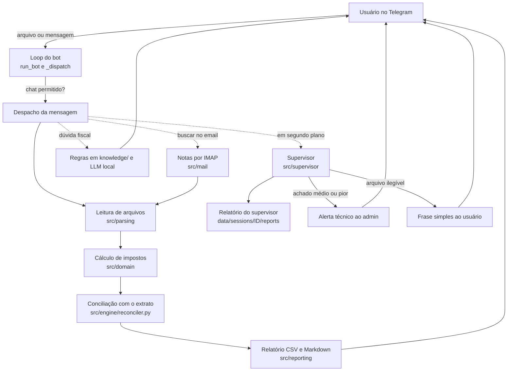

# Arquitetura

## Visão geral

O bot recebe arquivos e mensagens pelo Telegram, calcula impostos, concilia notas com o extrato e responde. Um módulo separado, o supervisor, audita o próprio bot.

## Componentes

- **Loop do bot** (`run_bot` e `_dispatch`, em `src/bot/telegram_bot.py`): pergunta ao Telegram por mensagens novas (long polling), guarda até onde já leu (`offset`) e tenta de novo depois de um erro. Só atende chats da lista permitida, se ela estiver preenchida.
- **E-mail** (`src/mail/imap_fetch.py`): busca notas na caixa de entrada por IMAP, filtrando pelo assunto.
- **Parsing** (`src/parsing/`): um leitor para cada formato (PDF, CSV, OFX, NF-e, NFS-e e foto por OCR).
- **Domínio** (`src/domain/`): modelos (`Transaction`, `Invoice`, `MatchResult`, `Inconsistency`), regras determinísticas (`rules.py`), cálculo de impostos (`tax.py`), base de conhecimento fiscal (`fiscal_kb.py`), alíquota interestadual de ICMS (`icms_rates.py`) e casos de DIFAL (`difal_case.py`).
- **Conciliação** (`src/engine/reconciler.py`): a classe `Reconciler` pareia transações do extrato com faturas e sinaliza divergências, faturas sem pagamento, duplicidades e atrasos. O pareamento usa as regras de `rules.py`, que rodam sem LLM; o LLM entra só como reforço, para classificar e para o pareamento aproximado.
- **Relatório** (`src/reporting/report.py`): grava um CSV detalhado e um Markdown legível.
- **Notificação** (`src/notify/telegram.py`): envia mensagens e relatórios pelo Telegram, inclusive os alertas do supervisor.
- **Supervisor** (`src/supervisor/`): 6 verificadores independentes. Ele detecta e relata, e nunca corrige nada sozinho. O `replay` usa o mesmo `Reconciler` para refazer a conciliação com o código atual.

## O supervisor

- **Ao vivo, por conversa:** quando o bot processa arquivos, `supervisor_audit` dispara uma thread por chat. Se chegar outro pedido enquanto uma auditoria roda, ele só marca uma segunda rodada (coalescing), em vez de abrir várias threads.
- **Sob demanda:** `python3 auditoria.py` roda tudo, inclusive `log_health` e `kb_consistency`, que não rodam ao vivo.
- **Quem recebe o quê:** o admin recebe o alerta técnico (fonte, evidência e sugestão). O usuário recebe no máximo uma frase simples sobre arquivos que ele pode reenviar.
- **Segurança:** todo texto enviado passa por `redact`, que mascara o token do Telegram.

## Decisões e limitações

- O supervisor nunca derruba o bot: erros dele são capturados e só imprimidos.
- O cálculo de impostos é determinístico; o LLM só ajuda em classificação, leitura de notas escaneadas e perguntas livres.
- A auditoria global ainda é manual.